# TensorBloom

**[tensorbloom.org](https://tensorbloom.org)** · [Try it in your browser](https://tensorbloom.org/app/) · [Docs](https://tensorbloom.org/docs) · [Download](https://github.com/mdsunbeam/tensorbloom/releases/latest) · [Roadmap](ROADMAP.md)

Build, train, and export PyTorch neural networks visually. Drag-and-drop layers, connect them, train on real datasets with GPU acceleration, watch what training does to every layer, and export to ONNX or TorchScript — all without writing boilerplate code.

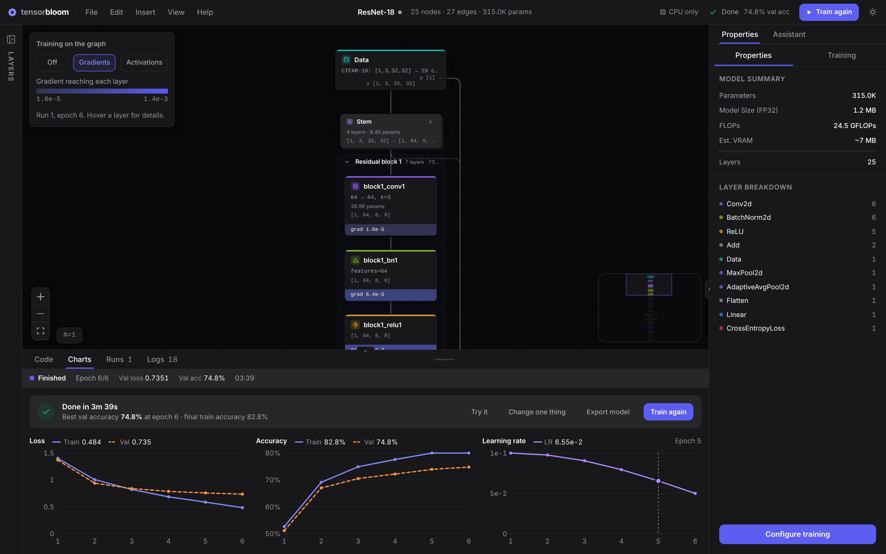

## Why TensorBloom?

- **See your architecture** — No more debugging invisible dimension mismatches in code. The graph shows every layer, every connection, and every tensor shape.
- **Train instantly** — Built-in datasets (MNIST, CIFAR, IMDB, and more), one-click training with live loss curves, and GPU auto-detection on NVIDIA and Apple Silicon.
- **Watch training on the graph** — Each layer is colored by its gradient or output spread while it trains, with dead ReLUs and vanishing or exploding gradients flagged, and feature maps on hover.
- **See what changed** — Every run is kept. **Change one thing** trains a variation and puts the two runs side by side with what changed, and **Try it** runs a trained model on samples it never saw.
- **Learn by doing** — 7 guided lessons that check your work as you go, an optional AI assistant that explains your model and can tutor the lessons, and 16 starter templates from Simple MLP to nanoGPT.
- **Real PyTorch underneath** — Every graph generates real `nn.Module` code. Export your model and use it anywhere.

## Features

**Graph Editor**
- 70+ PyTorch modules: Linear, Conv2d, Transformer, LSTM, BatchNorm, and more
- Drag-and-drop from the layer palette, Enter on a focused layer, or Ctrl+K spotlight search
- Eight layer color families, each with its own icon, so a layer's kind reads without relying on color
- Skip connections, concatenation, multi-branch architectures; skip connections run dotted beside the block they skip
- Group layers into named frames that collapse to a single card, without changing the model
- Reliable undo/redo, Save vs Save As, an unsaved-changes prompt, and auto-save you can restore or discard

**Shape Checking**
- Real-time shape inference on every edge and layer
- A shape error marks the edge *into* the layer that can't take it, shows "Gets [1, 512], expects [1, 500]" on the layer, and lists every problem in the toolbar
- One-click fixes such as "Set in_features to 512", from the problems list or the Properties panel

**Training**
- One-click training (Ctrl+Enter) with a live status in the toolbar: download, epoch progress, and the result
- Live loss/accuracy charts with a hover readout, and a summary card when the run ends
- Training shows on the graph: each layer is colored by its gradient size or output spread, flags dead ReLUs and vanishing or exploding gradients, and shows its output histogram and feature maps on hover
- Plain-language error panel with hints for shape mismatches, out-of-memory, bad labels, missing packages, and more
- Pre-flight fixes are listed for review (Fix and train, Train without changes, or Cancel) instead of being applied silently
- 10+ built-in datasets: MNIST, CIFAR-10/100, TinyShakespeare, WikiText-2, IMDB, AG News, SpeechCommands
- Custom tensor files (.pt, .npz, .safetensors), ImageFolder, HuggingFace datasets, CSV
- GPU acceleration with mixed precision support and VRAM monitoring
- Optimizers: SGD, Adam, AdamW, RMSprop | Schedulers: StepLR, Cosine, OneCycleLR, ReduceLROnPlateau

**Runs and Results**
- Every run is kept with its curves, settings, and model, saved in the project file
- The **Runs** tab overlays runs on shared charts and puts their results and settings side by side, highlighting what differs
- **Restore** brings back a run's graph and settings
- **Change one thing** starts from a run, tracks what you change, and puts the new run next to it with the graph diff beside the curves
- **Try it** runs a trained model on validation samples it didn't train on, shows its top guesses, filters to mistakes, or tries your own image

**Help Built In**
- A welcome card with starter models, a Getting Started guide, and a Help menu
- Guided lessons (**Help > Lessons**): fix a shape error, find a learning rate, stop overfitting, add BatchNorm, and more. Each starts from a real model and checks each step with hints when you're stuck
- A "?" next to every layer parameter and training setting explains what it does
- Each layer links to its PyTorch documentation
- **Help > Send Feedback** opens a feedback form with your app version filled in

**Assistant** (optional, with your own Anthropic API key)
- Ask about the model on your canvas, its shape errors, and your training runs
- Have it add or change layers, write a custom layer, or set up training: every change is previewed on the canvas for you to apply or discard
- It can tutor the guided lessons, with hints that don't give the answer away

**Language Models**
- Import an LLM from Hugging Face or a `.gguf`/`.safetensors` file without downloading it, and see its architecture as a graph
- See the memory it needs to run, LoRA fine-tune, or fully fine-tune at 16, 8 and 4 bits, against your GPU or Mac
- Chat with it, and fine-tune it with LoRA or QLoRA on your own data, with live loss charts

**Code Generation & Export**
- Live PyTorch code generation — see the equivalent `nn.Module` as you build
- Import existing PyTorch code into the graph editor
- Export to ONNX (for deployment) or TorchScript (for PyTorch-native use)
- Export a 3D architecture diagram for papers and slides as vector PDF, SVG or PNG (File > Export Diagram)

**Desktop App**
- Windows, Linux and Apple Silicon Macs; training uses the Mac GPU (MPS) on a Mac
- No Python needed first: the app installs a Python and PyTorch of its own the first time you train
- Updates itself: when a new version is out, a banner offers **Update and restart** (or **Help > Check for Updates**)

<details>
<summary>Training on the graph</summary>

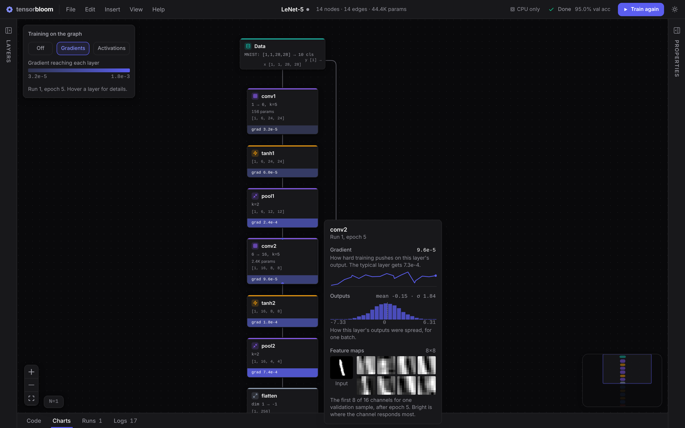
</details>

<details>
<summary>Change one thing and compare</summary>

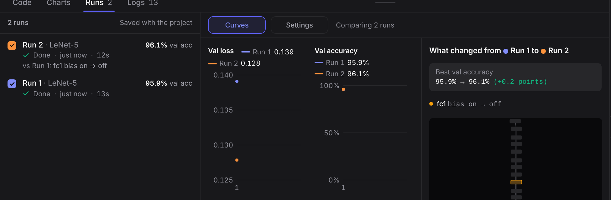

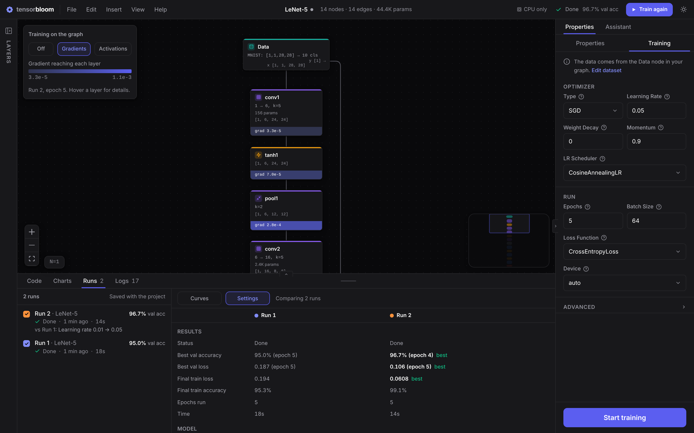
</details>

<details>
<summary>Try a trained model</summary>

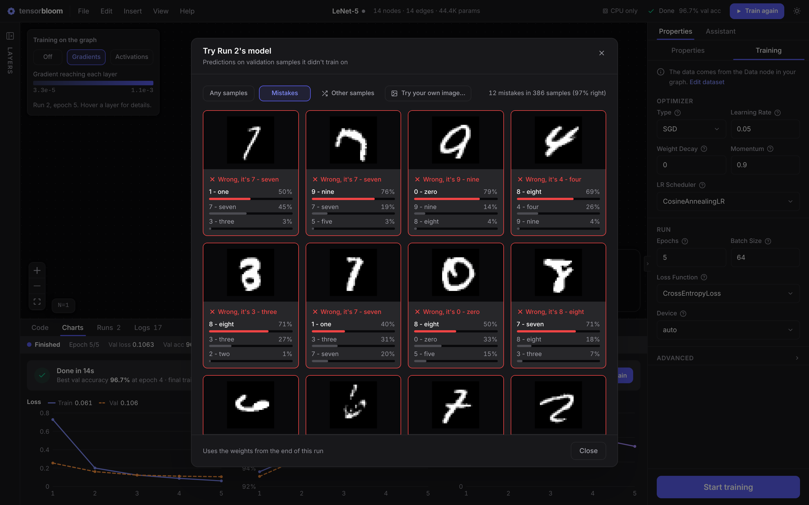
</details>

<details>
<summary>Guided lessons</summary>

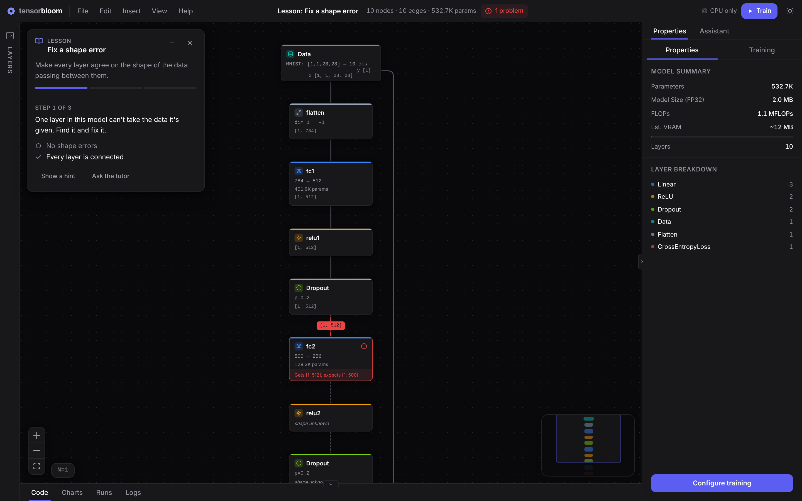
</details>

<details>
<summary>The assistant</summary>

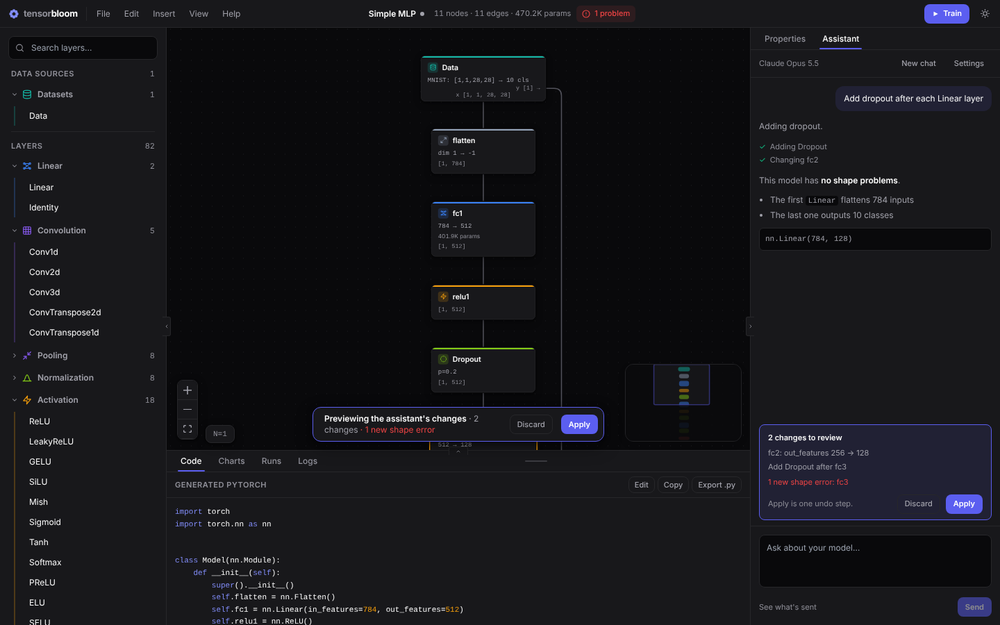
</details>

<details>
<summary>Language models</summary>

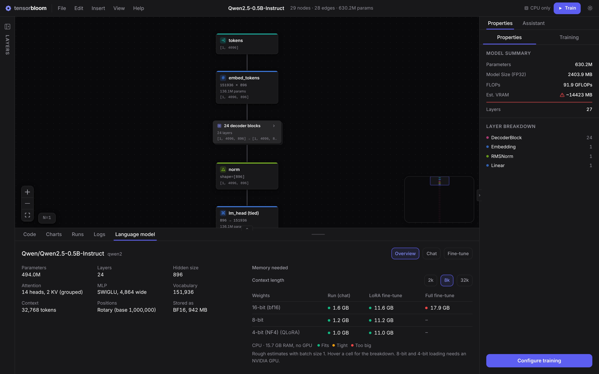
</details>

<details>
<summary>Shape error detection</summary>

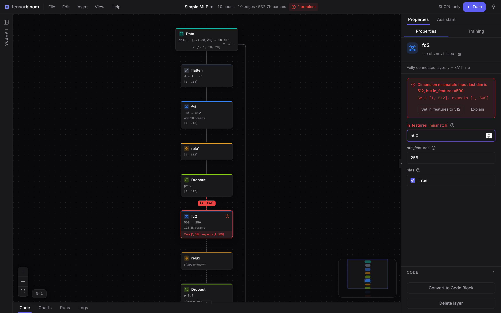
</details>

<details>
<summary>Layer groups</summary>

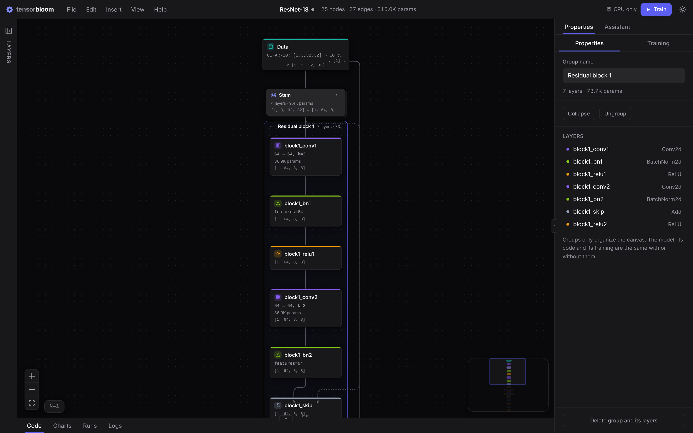
</details>

<details>
<summary>Parameter help</summary>

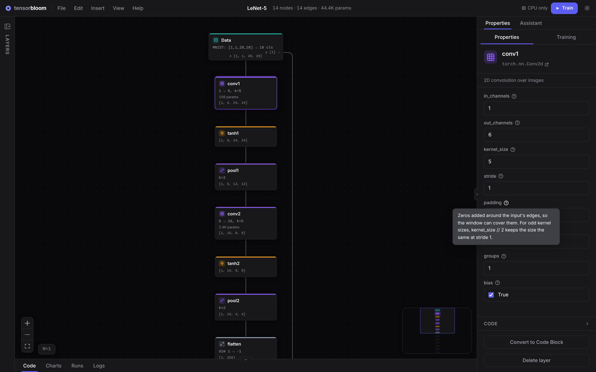
</details>

<details>
<summary>Generated PyTorch code</summary>

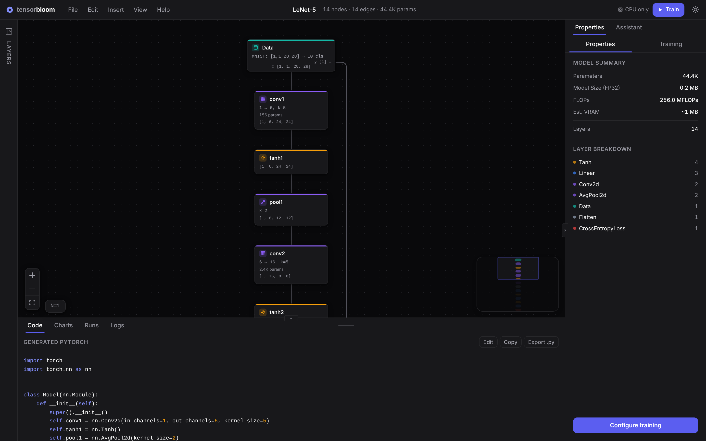
</details>

<details>
<summary>Custom blocks</summary>

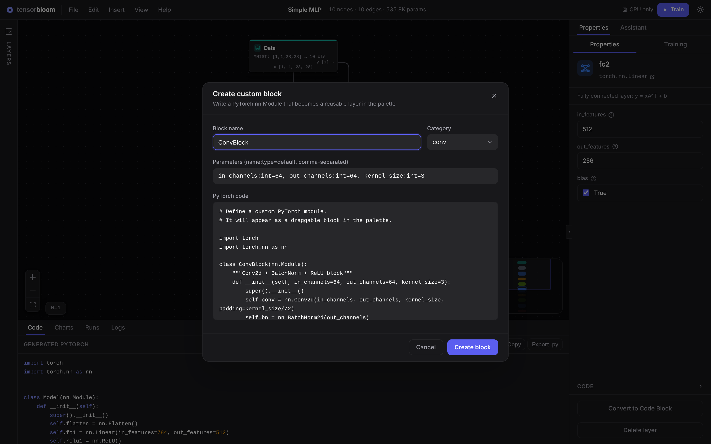
</details>

<details>
<summary>Light theme</summary>

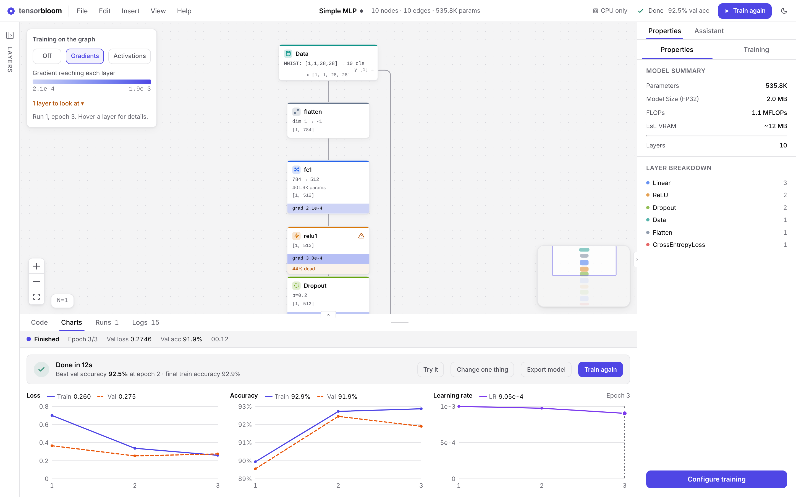
</details>

## Getting Started

### Download

Grab the latest installer from the [releases page](https://github.com/mdsunbeam/tensorbloom/releases/latest):

- **Windows** — `.exe` installer or `.msi`
- **Linux** — `.deb`, `.rpm`, or `.AppImage`
- **macOS** (Apple Silicon) — `.dmg`, from the next release on (v0.1.0 has Windows and Linux only)

Or try it in your browser first at **[tensorbloom.org/app](https://tensorbloom.org/app/)**: building, shape checking and code generation work there, and training needs the desktop app.

Nothing else needs to be installed. The editor opens right away; the first time you train, a card on the canvas downloads a Python and PyTorch of TensorBloom's own (about 500 MB, CPU build) and shows its progress while you keep building. If you have an NVIDIA GPU, the card then offers GPU support (CUDA) as an extra download. On a Mac, PyTorch uses the Apple GPU with nothing extra to install.

### Building from Source

For development or contributing:

```bash
git clone https://github.com/mdsunbeam/tensorbloom.git
cd tensorbloom/app
npm install
npx tauri dev
```

Requires Node.js 18+ and [Rust](https://rustup.rs/). `npx tauri dev` and `npx tauri build` download the [uv](https://github.com/astral-sh/uv) binary that the app bundles to install Python (`app/scripts/fetch-uv.mjs`). Python 3.10+ is only needed to run the Python tests.
**Windows:** also needs [C++ Build Tools](https://visualstudio.microsoft.com/visual-cpp-build-tools/).
**Linux:** `sudo apt install libwebkit2gtk-4.1-dev build-essential curl wget file libssl-dev libayatana-appindicator3-dev librsvg2-dev`

### Your First Model in 30 Seconds

1. On the empty canvas, pick **Simple MLP** from the welcome card (or go to **Insert > From Template** for all 16)

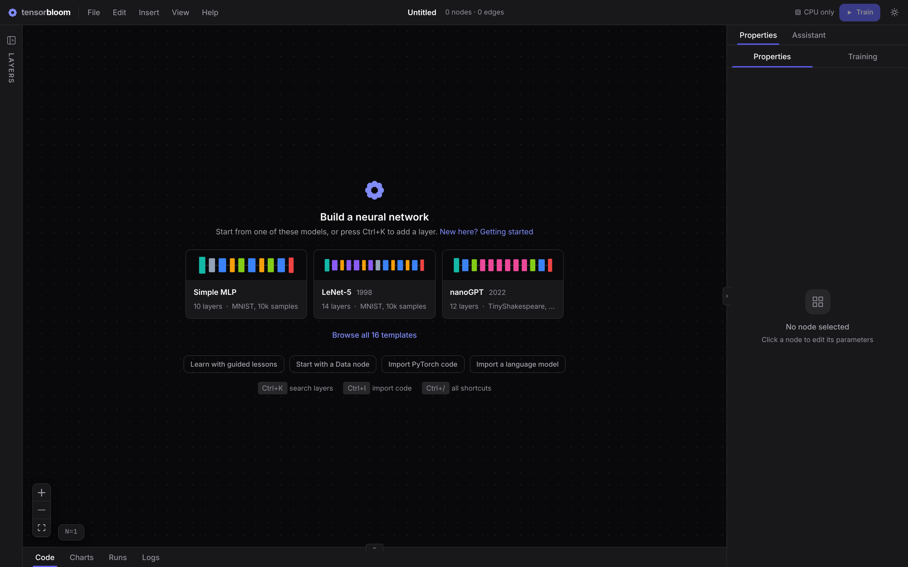

2. Press **Train** in the toolbar (or `Ctrl+Enter`) and watch the loss drop and accuracy climb in real time

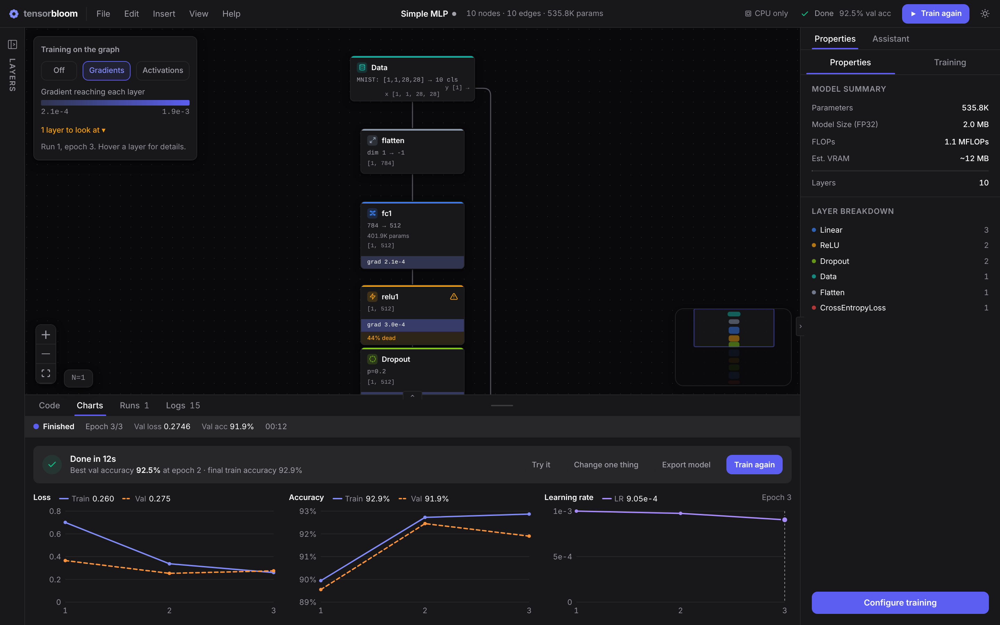

3. Look at the graph: each layer is colored by the gradient reaching it, and the **Training on the graph** card flags layers to look at. Hover a layer for its details.
4. Press **Try it** in the run summary to see the model's predictions on digits it didn't train on, or **Change one thing** to train a variation and compare

From here: click any node to edit parameters, swap the dataset, add layers, or try a different template. New to TensorBloom? **Help > Getting Started** walks through the steps, and **Help > Lessons** has seven guided lessons.

## Templates

16 pre-built architectures, ready to train:

| Category | Templates |
|----------|-----------|
| Getting Started | Simple MLP |
| Vision | LeNet-5, ResNet-18, ViT, MobileNetV2, U-Net |
| Language | Transformer, nanoGPT, BERT Base, LSTM Classifier |
| Audio | Whisper Encoder, WaveNet Block |
| Generative | Autoencoder, Conv Autoencoder, Embedding Classifier |
| Other | DenseNet Block |

Go to **Insert > From Template** to load any template. Each card shows a preview of the model's layout.

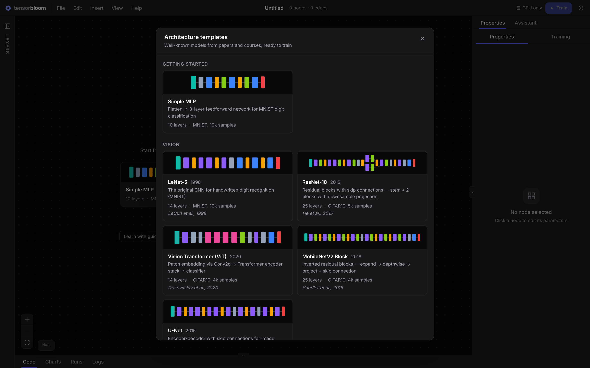

## Keyboard Shortcuts

| Shortcut | Action |
|----------|--------|
| `Ctrl+Enter` | Start training |
| `Ctrl+K` | Add any layer (spotlight search) |
| `Ctrl+J` | Open the assistant |
| `Ctrl+S` / `Ctrl+Shift+S` | Save / Save As |
| `Ctrl+O` | Open project |
| `Ctrl+N` | New project |
| `Ctrl+Z` / `Ctrl+Shift+Z` or `Ctrl+Y` | Undo / Redo |
| `Ctrl+C` / `Ctrl+V` | Copy / Paste nodes |
| `Ctrl+D` | Duplicate selected |
| `Ctrl+A` | Select all |
| `Ctrl+G` / `Ctrl+Shift+G` | Group selected layers / Ungroup |
| `Ctrl+L` | Auto-layout graph |
| `Ctrl+I` | Import PyTorch code |
| `Ctrl+E` | Export model |
| `Ctrl+B` / `Ctrl+.` | Toggle side panels |
| `Ctrl+M` | Toggle minimap |
| `Ctrl+\` | Focus on the canvas (hide every panel) |
| `Ctrl+/` | Show all shortcuts |
| `Delete` | Delete selected |
| `Escape` | Close the open dialog or menu |
| Scroll / `Ctrl+Scroll` | Pan / Zoom |
| Double-click | Rename node |

## Known Limitations

TensorBloom v0.1 focuses on standard feedforward, convolutional, recurrent, and transformer architectures. The following are not yet supported:

- **GANs and adversarial training** — no multi-model training loops
- **Multi-loss training** — only one loss node per graph
- **Attention masks** — Transformer nodes don't accept mask inputs
- **Distributed training** — single GPU only (multi-GPU DDP planned for v0.4)
- **Dynamic architectures** — model structure is static at graph definition time

See the [Roadmap](ROADMAP.md) for planned features.

## Documentation

Full docs at **[tensorbloom.org/docs](https://tensorbloom.org/docs)**, or browse locally:

- [Getting Started](docs/guides/getting-started.md) — Build and train your first model
- [Custom Data Guide](docs/guides/custom-data.md) — Load your own datasets
- [Code Blocks](docs/guides/code-blocks.md) — Write custom forward() logic
- [The Assistant](docs/guides/assistant.md) — Ask about your model and runs, or have it make changes you review
- [Training Guide](docs/guides/training.md) — Training settings, the run flow, comparing runs, and trying a model
- [Exporting Models](docs/guides/export.md) — ONNX, TorchScript, and Python export
- [Language Models](docs/guides/language-models.md) — Import an LLM, size it for your computer, chat with it, and fine-tune it with LoRA
- [Template Reference](docs/guides/templates.md) — All 16 built-in architectures
- [Lessons](docs/guides/lessons.md) — The guided lessons, and the lesson format for adding your own
- [Architecture](docs/guides/architecture.md) — Technical internals for contributors
- [Roadmap](ROADMAP.md) — Planned features and development direction

## Building for Production

```bash
cd app
npx tauri build
```

Produces platform-specific installers in `app/src-tauri/target/release/bundle/`.

### Web version

The same app runs in a plain browser with no install. Building, shape checking, code generation, saving (as a download) and share links work there; training, code import and ONNX export point to the desktop app, because they need Python.

```bash
cd app
npm run build:web   # static files in app/dist-web, served from /app/
```

Links can open a model: `/app/?template=resnet-18` opens a template (its name in lowercase, with dashes), and File > Copy Share Link packs the current model into the link's `#m=` fragment, so nothing is stored on a server.

## Contributing

See [CONTRIBUTING.md](CONTRIBUTING.md) for development setup and guidelines.

## License

[MIT](LICENSE)
