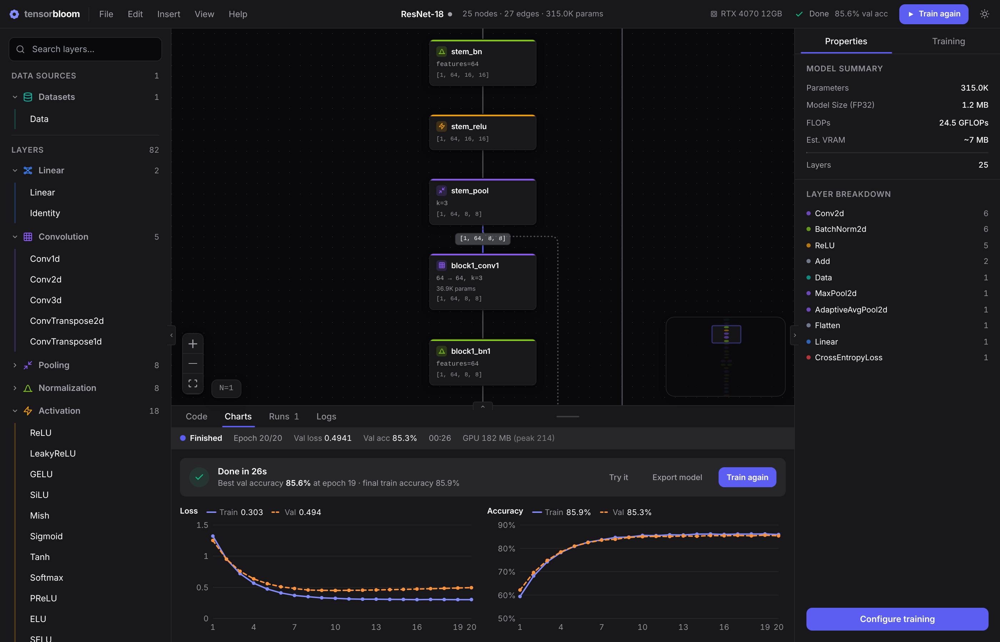
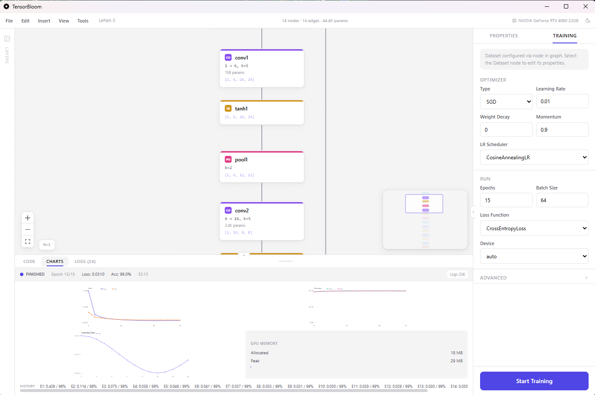
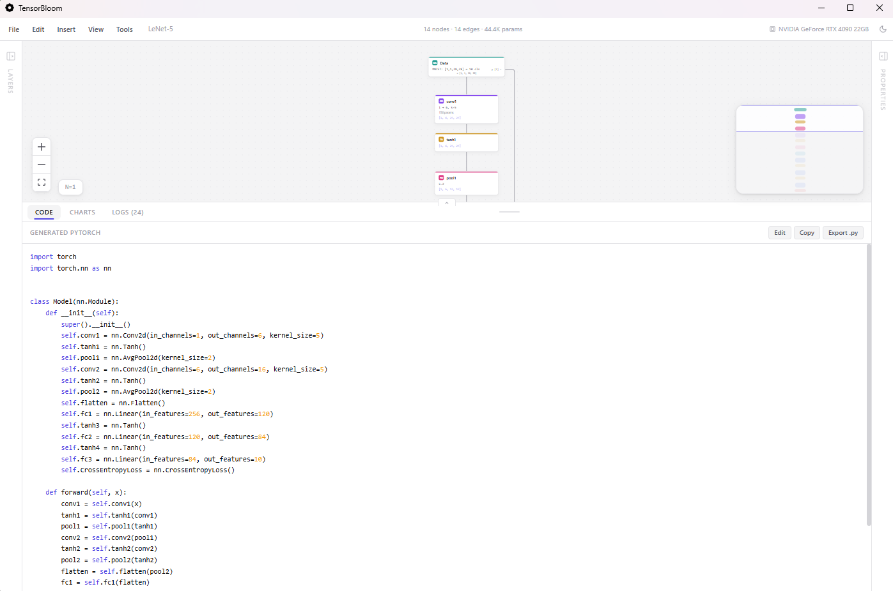
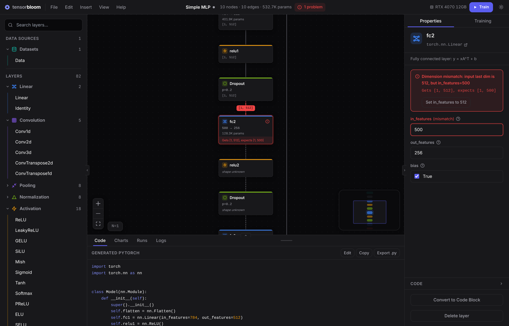
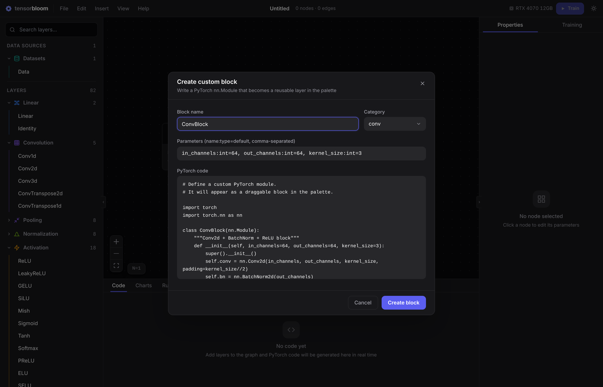
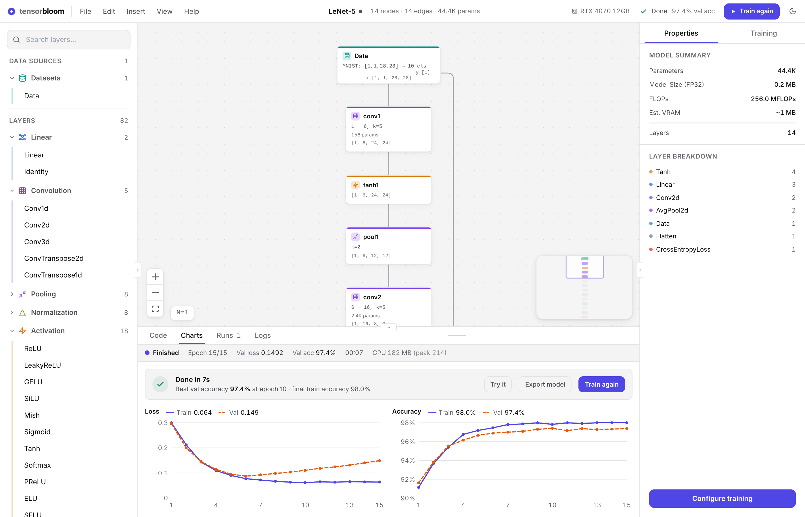
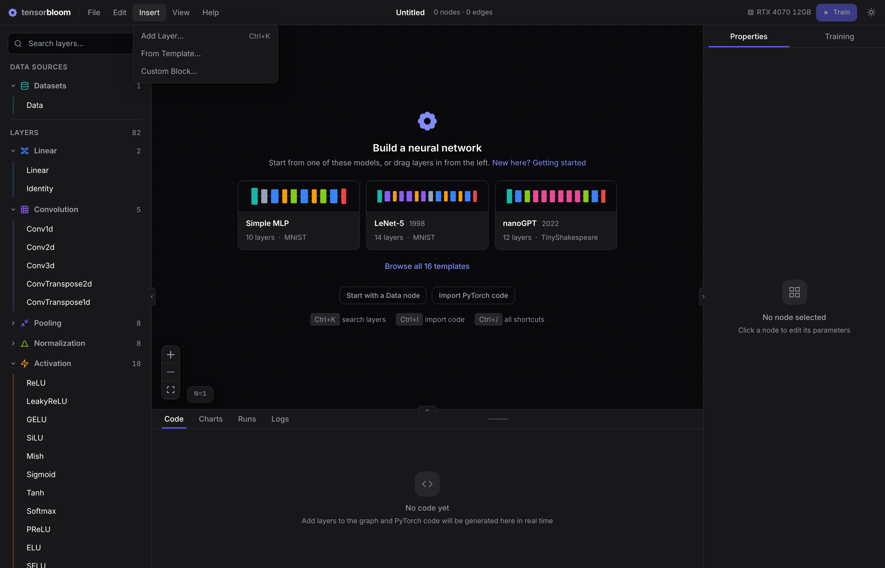
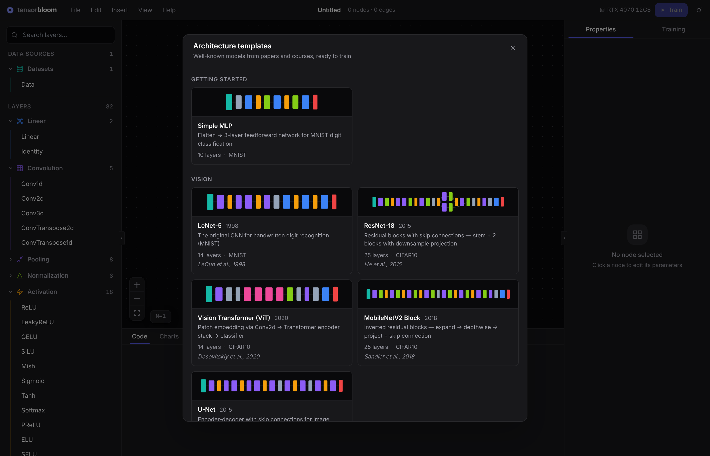

# TensorBloom

**[tensorbloom.org](https://tensorbloom.org)** · [Docs](https://tensorbloom.org/docs) · [Download](https://github.com/mdsunbeam/tensorbloom/releases/latest) · [Roadmap](ROADMAP.md)

Build, train, and export PyTorch neural networks visually. Drag-and-drop layers, connect them, train on real datasets with GPU acceleration, and export to ONNX or TorchScript — all without writing boilerplate code.



## Why TensorBloom?

- **See your architecture** — No more debugging invisible dimension mismatches in code. The graph shows every layer, every connection, and every tensor shape.
- **Train instantly** — Built-in datasets (MNIST, CIFAR, IMDB, and more), one-click training with live loss curves, and GPU auto-detection.
- **Learn by doing** — 16 starter templates from Simple MLP to nanoGPT. Load one, modify it, train it, see what happens.
- **Real PyTorch underneath** — Every graph generates real `nn.Module` code. Export your model and use it anywhere.

## Features

**Graph Editor**
- 70+ PyTorch modules: Linear, Conv2d, Transformer, LSTM, BatchNorm, and more
- Drag-and-drop from the layer palette, or Ctrl+K spotlight search
- Skip connections, concatenation, multi-branch architectures
- Real-time shape inference with dimension error detection

**Training**
- One-click training with live loss/accuracy charts
- 10+ built-in datasets: MNIST, CIFAR-10/100, TinyShakespeare, WikiText-2, IMDB, AG News, SpeechCommands
- Custom tensor files (.pt, .npz, .safetensors), ImageFolder, HuggingFace datasets, CSV
- GPU acceleration with mixed precision support and VRAM monitoring
- Optimizers: SGD, Adam, AdamW, RMSprop | Schedulers: StepLR, Cosine, OneCycleLR, ReduceLROnPlateau

**Smart Auto-Fix**
- Detects and auto-corrects dimension mismatches before training starts
- Fixes `in_features`, `in_channels`, `num_features`, and `out_features` based on shape inference
- Warns about loss function / target type incompatibilities

**Code Generation & Export**
- Live PyTorch code generation — see the equivalent `nn.Module` as you build
- Import existing PyTorch code into the graph editor
- Export to ONNX (for deployment) or TorchScript (for PyTorch-native use)

<details>
<summary>Training configuration</summary>


</details>

<details>
<summary>Generated PyTorch code</summary>


</details>

<details>
<summary>Shape error detection</summary>


</details>

<details>
<summary>Custom blocks</summary>


</details>

<details>
<summary>Light theme</summary>


</details>

## Getting Started

### Download

Grab the latest installer from the [releases page](https://github.com/mdsunbeam/tensorbloom/releases/latest):

- **Windows** — `.exe` installer or `.msi`
- **Linux** — `.deb`, `.rpm`, or `.AppImage`

**Requirement:** Python 3.9+ must be installed. PyTorch is installed automatically on first launch.

### Building from Source

For development or contributing:

```bash
git clone https://github.com/mdsunbeam/tensorbloom.git
cd tensorbloom/app
npm install
npx tauri dev
```

Requires Node.js 18+, [Rust](https://rustup.rs/), and Python 3.9+.
**Windows:** also needs [C++ Build Tools](https://visualstudio.microsoft.com/visual-cpp-build-tools/).
**Linux:** `sudo apt install libwebkit2gtk-4.1-dev build-essential curl wget file libssl-dev libayatana-appindicator3-dev librsvg2-dev`

### Your First Model in 30 Seconds

1. Go to **Insert > From Template**



2. Pick **Simple MLP** from the template browser — loads a 3-layer network for MNIST



3. **Click Start Training** — watch the loss drop and accuracy climb in real time

From here: click any node to edit parameters, swap the dataset, add layers, or try a different template.

## Templates

16 pre-built architectures, ready to train:

| Category | Templates |
|----------|-----------|
| Getting Started | Simple MLP |
| Vision | LeNet-5, ResNet-18, ViT, MobileNetV2, U-Net |
| Language | Transformer, nanoGPT, BERT Base, LSTM Classifier |
| Audio | Whisper Encoder, WaveNet Block |
| Generative | Autoencoder, Conv Autoencoder, Embedding Classifier |
| Other | DenseNet Block |

Go to **Insert > From Template** to load any template.

## Keyboard Shortcuts

| Shortcut | Action |
|----------|--------|
| `Ctrl+K` | Add any layer (spotlight search) |
| `Ctrl+S` | Save project |
| `Ctrl+O` | Open project |
| `Ctrl+N` | New project |
| `Ctrl+Z` / `Ctrl+Y` | Undo / Redo |
| `Ctrl+C` / `Ctrl+V` | Copy / Paste nodes |
| `Ctrl+D` | Duplicate selected |
| `Ctrl+A` | Select all |
| `Ctrl+G` | Group selected into block |
| `Ctrl+L` | Auto-layout graph |
| `Ctrl+I` | Import PyTorch code |
| `Ctrl+E` | Export model |
| `Ctrl+B` / `Ctrl+.` | Toggle side panels |
| `Ctrl+M` | Toggle minimap |
| `Ctrl+?` | Show all shortcuts |
| `Delete` | Delete selected |
| Double-click | Rename node |

## Known Limitations

TensorBloom v0.1 focuses on standard feedforward, convolutional, recurrent, and transformer architectures. The following are not yet supported:

- **GANs and adversarial training** — no multi-model training loops
- **Multi-loss training** — only one loss node per graph
- **Attention masks** — Transformer nodes don't accept mask inputs
- **Distributed training** — single GPU only (multi-GPU DDP planned for v0.4)
- **Dynamic architectures** — model structure is static at graph definition time

See the [Roadmap](ROADMAP.md) for planned features.

## Documentation

Full docs at **[tensorbloom.org/docs](https://tensorbloom.org/docs)**, or browse locally:

- [Getting Started](docs/guides/getting-started.md) — Build and train your first model
- [Custom Data Guide](docs/guides/custom-data.md) — Load your own datasets
- [Code Blocks](docs/guides/code-blocks.md) — Write custom forward() logic
- [Exporting Models](docs/guides/export.md) — ONNX, TorchScript, and Python export
- [Template Reference](docs/guides/templates.md) — All 16 built-in architectures
- [Architecture](docs/guides/architecture.md) — Technical internals for contributors
- [Roadmap](ROADMAP.md) — Planned features and development direction

## Building for Production

```bash
cd app
npx tauri build
```

Produces platform-specific installers in `app/src-tauri/target/release/bundle/`.

## Contributing

See [CONTRIBUTING.md](CONTRIBUTING.md) for development setup and guidelines.

## License

[MIT](LICENSE)
