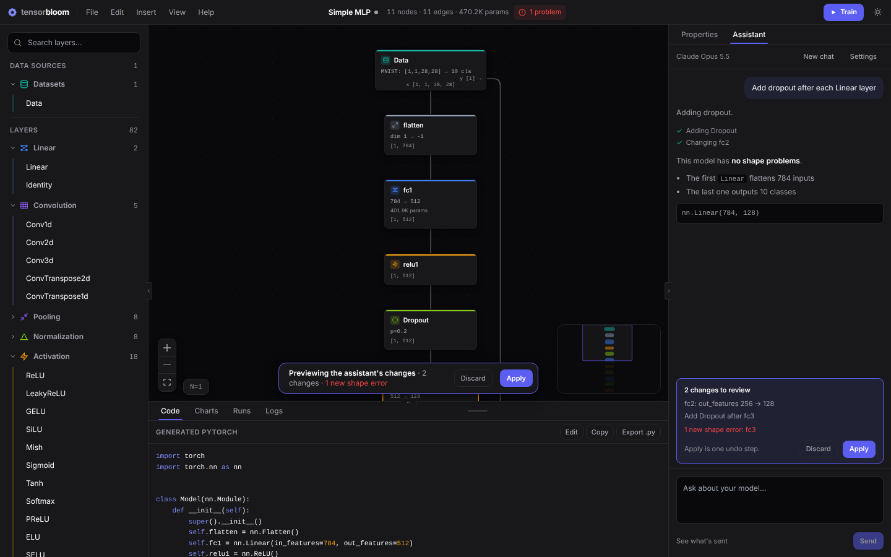
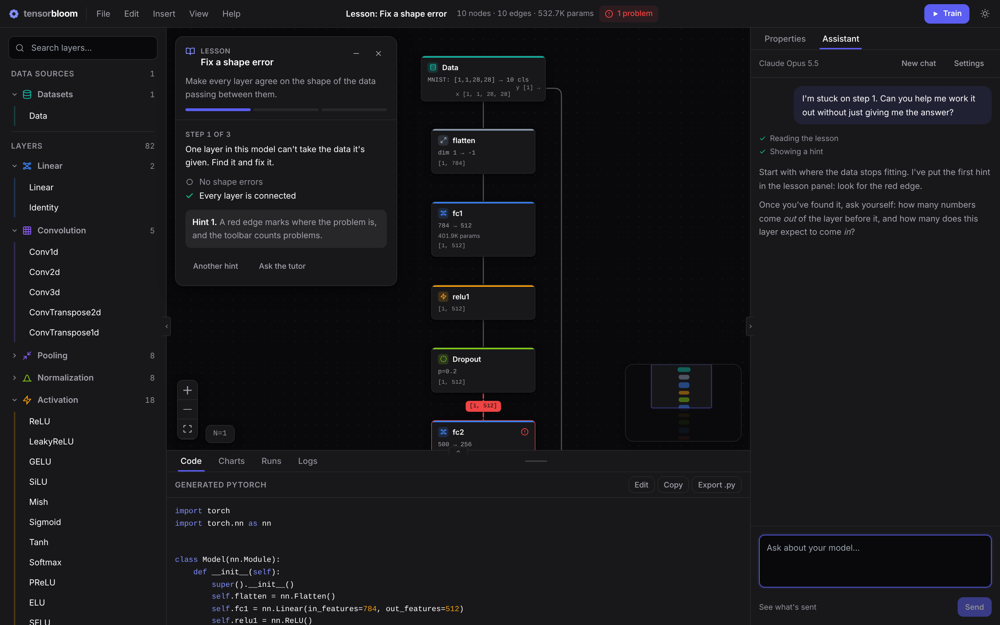

# The Assistant

The assistant is a chat panel that can read the model on your canvas, its generated code, your training runs and your dataset's statistics. Ask it why a shape is wrong, what a layer does, where the parameters go, or why a run's validation loss went up.

Open it with the **Assistant** tab at the top of the right panel, or press **Ctrl+J**. Shape errors in the Properties panel also have an **Explain** button that opens the assistant with the question ready.

## Setting it up

The assistant uses Claude through your own Anthropic API key, billed to your Anthropic account.

1. Create a key at [console.anthropic.com](https://console.anthropic.com/settings/keys).
2. Open the assistant. The first time, it shows its settings. Paste the key and press **Save**.

The key is kept in your operating system's keychain (Keychain on macOS, Credential Manager on Windows, the Secret Service on Linux). Only the app's native side reads it; the interface never sees it again, and it's never written to project files. **Settings > Remove key** deletes it. When developing, the app also uses the `ANTHROPIC_API_KEY` environment variable if no key is saved.

**Settings** also picks the model: Claude Opus 5.5 (the default), Claude Sonnet 5.5 (faster and cheaper) or Claude Haiku 5.5 (fastest and cheapest).

## What it can do

The assistant can look at:

- The graph: every layer, its parameters, connections and output shapes
- Shape problems and the app's one-click fixes
- The layer catalog: every layer's parameters and what they mean
- The generated PyTorch code
- Runs: settings, per-epoch curves and results, and what changed between two runs
- A trained run's predictions on validation samples, including the mistakes (needs Python)
- Dataset statistics: sizes, sample shape, classes, input mean and range (needs Python)

And it can change the model when you ask: add, remove and connect layers, change their settings, apply shape fixes, group layers, tidy the layout, and change training settings. Try "add dropout after each Linear layer" or "make fc2 smaller and fix the shapes".

It can also build whole models: open a template, or design an architecture from a description ("a small CNN for CIFAR-10 with batch norm") or from a paper's text. When no built-in layer does the job, it can write a custom layer with its own `forward()`, turn PyTorch code into a graph, and start or stop training.

## Reviewing its changes

The assistant's changes show on the canvas as a preview while it works: added layers and connections in green, changed layers in amber, and removed ones as faded red outlines. A bar at the bottom of the canvas, and a card above the message box, list the changes and any new shape errors.

- **Apply** keeps them. All of them together are one undo step, so **Ctrl+Z** takes them back.
- **Discard** puts the model and training settings back exactly as they were.

While a preview is showing, the canvas can't be edited and undo is off. The assistant checks every layer type and setting against the catalog, and fixes the shape errors its changes cause before it hands them over. Opening another project or template keeps pending changes as an undo step.

## Tutoring a lesson

While a [guided lesson](lessons.md) is open, the assistant acts as its tutor. It knows the lesson's goal, the step you're on, whether the step passes yet and which hints you've seen. It answers questions and explains ideas, but it nudges you toward the step rather than doing it for you. When you need more, it reveals the lesson's next hint in the lesson panel, so the panel and the chat stay in step. Ask it to just do the step and it will, then explain why it works.

**Ask the tutor** on the lesson panel opens the chat with a question about the step, which you can edit before sending.

A few things work differently during a lesson:

- A step the assistant's changes would complete only counts once you apply them.
- It won't replace the whole model or import code, since that would replace the lesson's model. Leave the lesson first.
- It doesn't start training unless you ask, because running it is part of the lesson.

Without a lesson open, ask it to teach you something ("I want to understand overfitting") and it can suggest a lesson that covers it and open it once you agree. Opening a lesson replaces the canvas, so it asks first.

## Code it runs

Custom layers, importing code and training run Python on your computer, with the same access to your files as TensorBloom. So before any of them, the assistant shows a card with exactly what will run (the full code for a custom layer or an import, the settings for a training run) and waits. **Don't run** declines, and the assistant won't retry the same thing. A custom layer you approve is then previewed like any other change.

## What's sent

Each message sends your question along with a snapshot of the app: the layers and their settings, shape problems, the selected layer, the training settings and a summary of recent runs. **See what's sent** under the message box shows that snapshot exactly. When the assistant asks for more, the app also sends the generated code, run curves, predicted classes and dataset statistics.

Dataset contents such as images and text stay on your computer.
