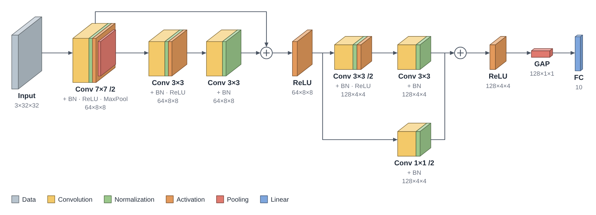

# Exporting Models

TensorBloom can export your trained model in three formats: ONNX, TorchScript, and Python code.

## Exporting

Go to **File > Export Model** (or `Ctrl+E`) to open the export dialog.

### Weights

Choose which weights go into the exported file:

- **Last training run** (default) — the weights from the most recent training run in this session, including runs you stopped early
- **Checkpoint file** — any checkpoint saved during training (defaults to the latest one)
- **Untrained** — the architecture with freshly initialized weights

If you change the graph after training, the saved weights no longer fit and export tells you so. Retrain, or pick a checkpoint that matches the current graph.

Checkpoints are saved every 5 epochs and at the end of training, in a folder per run under the app's data directory. The training log prints the folder at the start of each run.

## ONNX

**Best for:** Production deployment, cross-framework compatibility, inference optimization.

ONNX (Open Neural Network Exchange) is the industry standard for deploying models across frameworks and runtimes:
- **ONNX Runtime** — fast CPU/GPU inference
- **TensorRT** — NVIDIA GPU optimization
- **Web** — ONNX.js / onnxruntime-web for browser inference
- **Mobile** — ONNX Runtime Mobile for iOS/Android

### How it works

TensorBloom traces your model with a sample input and exports the traced graph to ONNX format. The export uses `torch.onnx.export` under the hood.

### Limitations

- Models with **dynamic control flow** (if/else based on tensor values) may not export correctly
- **Code blocks** with unsupported operations may fail
- Input shapes are fixed at export time (dynamic axes are not yet supported)

## TorchScript

**Best for:** PyTorch-native deployment, models that stay in the PyTorch ecosystem.

TorchScript serializes your model into a format that can be loaded in C++ or Python without the original model definition code.

### Trace vs Script

TensorBloom offers two TorchScript methods:

| Method | When to Use | Limitations |
|--------|-------------|-------------|
| **Trace** | Simple feedforward models, no control flow | Cannot capture if/else, loops based on data |
| **Script** | Models with control flow, dynamic behavior | Requires all code to be TorchScript-compatible |

**Default:** Trace. Use Script only if your model has conditional logic in code blocks.

### How it works

- **Trace:** Runs the model once with a sample input and records all operations
- **Script:** Compiles the Python code to TorchScript IR (intermediate representation)

## Python Code

The **Code** panel at the bottom of the app always shows the generated PyTorch code. You can:

- **Copy** — Click the `Copy` button to copy the code to your clipboard
- **Export .py** — Click `Export .py` to save as a Python file
- **Edit** — Click `Edit` to open the code in an editable text area, make changes, and re-import

The generated code is a standard `nn.Module` class that you can use in any PyTorch project:

```python
import torch
import torch.nn as nn

class Model(nn.Module):
    def __init__(self):
        super().__init__()
        self.flatten = nn.Flatten()
        self.fc1 = nn.Linear(784, 512)
        self.relu1 = nn.ReLU()
        self.fc2 = nn.Linear(512, 10)

    def forward(self, x):
        x = self.flatten(x)
        x = self.relu1(self.fc1(x))
        return self.fc2(x)
```

## Architecture Diagrams

**File > Export Diagram** (`Ctrl+Shift+E`) draws the model as a 3D figure for a paper, poster or slides, with a live preview.



- Each layer is a shaded block sized by its output tensor: channels set its depth along the flow, height and width set its face. Sizes are on a log scale so a 512-channel layer doesn't swallow the figure.
- BatchNorm, activations and pooling fold onto the layer before them as colored bands (`Conv 3×3` with `+ BN · ReLU` underneath), the way most papers draw them. Dropout is named in the caption.
- Identical layers in a row become one stacked block, such as `Encoder ×12`.
- Skip connections arc over the blocks they skip. Side branches, extra inputs and extra heads run in lanes below the main path.
- Flatten and other reshapes, loss layers and the dataset's labels are left out. A collapsed group is drawn as one block named after the group.

Options:

| Option | Choices |
|--------|---------|
| View | 3D (oblique), Isometric, Flat |
| Colors | Paper (soft print colors), App (the canvas colors), Gray |
| Layer names | Type (`Conv 3×3 /2`, `FC`), the node's name, or none |
| Show | Tensor shapes, legend, white or transparent background |

Formats:

- **PDF** — vector, one page sized to the figure, using the built-in Helvetica font. Use it with `\includegraphics` in LaTeX.
- **SVG** — vector, editable in Inkscape, Illustrator or Figma. **Copy SVG** puts it on the clipboard.
- **PNG** — 2× or 4× resolution, for slides.

## Tips

- **Train before exporting** — Export uses the weights from your last training run. Train first, or pick a checkpoint file.
- **Test the export** — Load the exported model in a separate script and verify it produces the same outputs.
- **ONNX for production** — If deploying to a server or edge device, ONNX with runtime optimization is usually the best choice.
- **Code for research** — If you want to continue developing the model in a Jupyter notebook or script, export the Python code.
