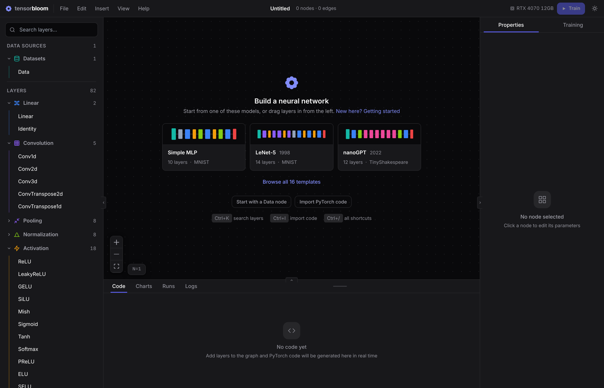
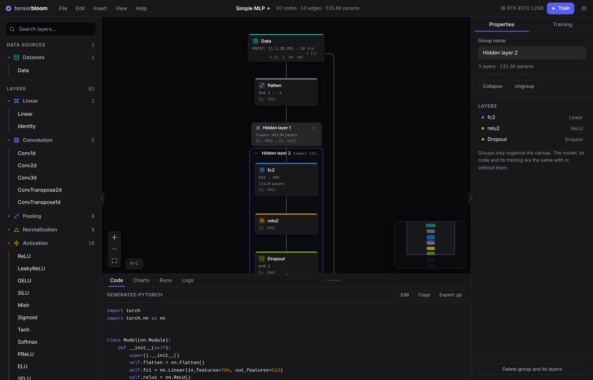

# Getting Started

This guide walks you through building and training your first neural network in TensorBloom.

## Python Setup

TensorBloom trains with PyTorch in a Python environment of its own. The editor opens right away, so you can start building while that environment is set up:

- If PyTorch isn't installed yet, a card on the canvas offers to set it up. Pick **Set up now** or **Later**.
- The card shows each step and the download progress. **Show details** opens the full log.
- Hiding the card keeps the current step in the toolbar. Click it to bring the card back.
- Training, code import, the dataset tools, and export need Python. Using one of them before setup opens the card and says why.

You need Python 3.9 or newer on your computer. If it can't be found, the card links to python.org.

## Your First Model

### 1. Open a Template

On an empty canvas, the welcome card offers three starter models. Pick **Simple MLP**, a 3-layer feedforward network for MNIST digit classification. For all 16 templates, use **Browse all templates** or **Insert > From Template**. Each template card shows a preview of the model's layout.

The graph shows the architecture:
- **Data** node provides MNIST images
- **Flatten** converts 28x28 images to 784-dimensional vectors
- Three **Linear** layers with **ReLU** activations and **Dropout**
- **CrossEntropyLoss** compares predictions against labels

Each layer's color and icon show its family (data, dense, spatial, regularization, activation, sequence, loss, utility).

### 2. Explore the Graph

- **Click a node** to see its parameters in the Properties panel. The **?** next to each parameter explains it, and the `torch.nn.…` caption under the layer's name opens its PyTorch docs.
- **Scroll** to pan, **Ctrl+Scroll** to zoom, or **drag** the empty canvas to pan. Below 50% zoom, nodes show only their titles.
- **Ctrl+L** auto-layouts the graph
- The **Code** panel at the bottom shows the equivalent PyTorch code in real time

### 3. Train the Model

1. Press **Train** in the toolbar, or **Ctrl+Enter**. The optimizer, learning rate, epochs, and loss function are pre-configured in the **Training** tab of the right panel.
2. The toolbar shows the run's status: the dataset download, then "Epoch 3 of 10" with a progress bar. Click it to open the **Charts** tab.
3. Watch the loss and accuracy curves. Hover a chart to read each value at that epoch.
4. When the run ends, a summary card shows how long it took and the best validation accuracy, with **Try it**, **Export model**, and **Train again**.

If the run can't start or fails, an error panel explains the likely cause in plain language, with **Try again**, **Show logs**, and **Copy error**.

### 4. Try the Trained Model

Press **Try it** in the summary to see the model's predictions on 12 validation samples it didn't train on: each one's top three guesses, and whether it was right. Switch to **Mistakes**, load **Other samples**, or **Try your own image**. See the [Training guide](training.md#trying-a-trained-model) for more.

### 5. Save Your Project

**Ctrl+S** or **File > Save** saves a `.tbloom` file that preserves your graph, groups, parameters, training configuration, and run history. Once the project has a file, Ctrl+S saves to it directly. **Ctrl+Shift+S** (**File > Save As…**) saves to a new location.

A dot next to the project name means there are unsaved changes. New, Open, opening a template, importing code, and closing the window all ask before discarding them.

**Help > Getting Started** shows these steps inside the app.

## Building from Scratch

### Adding Layers

Three ways to add layers:

1. **From the left panel** — Browse categories (Linear, Convolution, Activation, etc.) and drag a layer onto the canvas, or click it (or Tab to it and press Enter) to add it
2. **Ctrl+K** — Opens a spotlight search. Type "conv2d" or "relu" to find any layer instantly
3. **Drag from a handle** — Drag from a node's output handle onto empty canvas to open the layer picker with auto-connect

### Connecting Layers

Drag from one node's output handle (bottom) to another node's input handle (top). TensorBloom validates connections and shows shape information on each edge.

### Configuring Parameters

Click any node to edit its parameters in the Properties panel. For example, click a Conv2d node to set:
- `in_channels` / `out_channels`
- `kernel_size`, `stride`, `padding`
- `bias`, `groups`

Shape inference runs automatically — you'll see the output shape update on the node as you change parameters.

### Shape Errors

If dimensions don't match (e.g., a Linear layer expects 500 features but receives 512), TensorBloom shows:
- A **red edge** into the layer that can't take its input, labelled with the shape it carries (for example `[1, 512]`)
- A **red border** and alert icon on that layer, with "Gets [1, 512], expects [1, 500]" where its shape would be. Layers after it say "shape unknown" until the problem is fixed.
- **"1 problem"** in the toolbar. Its list shows each layer where a problem starts. Click one to select it and center the canvas on it.
- An **error banner** in the Properties panel. When one parameter is wrong, the banner and the problems list both offer the fix, such as **Set in_features to 512**.

When you start training, the pre-flight check lists any fixes it suggests, each with its reason. Choose **Fix and train**, **Train without changes**, or **Cancel**. Applied fixes are one undo step.

## Using Custom Data

### Built-in Datasets

Drop a **Data** node and select a preset: MNIST, CIFAR-10, TinyShakespeare, IMDB, SpeechCommands, and more. Everything is auto-configured.

### Custom Tensor Files

1. Drop a **Data** node, select **Custom Tensors**
2. Browse or type a path to your `.pt`, `.npz`, or `.safetensors` file
3. Click **Scan Data** to discover the tensors inside
4. Assign roles: which tensor is the **Model Input** and which is the **Loss Target**
5. Connect the Data node to your model and train

Your tensor file should be a dictionary of tensors saved with `torch.save({"features": X, "labels": y}, "data.pt")`.

## Copy, Paste & Grouping

- **Ctrl+C / Ctrl+V** — Copy and paste selected nodes (with edges between them preserved)
- **Ctrl+D** — Duplicate selected nodes in place
- **Ctrl+G** — Group the selected layers into a named frame. Type a name on the frame's title bar, drag the title bar to move the whole group, and use the arrow to collapse it into a single card. Groups only organize the canvas: the model, its code and its training are the same with or without them, and groups are saved with the project.
- **Ctrl+Shift+G** — Ungroup, keeping the layers
- **Ctrl+A** — Select all nodes

A collapsed group shows its layer count, parameters, and input → output shapes, plus "N problems inside" when one of its layers has a shape error. Right-click a group for Rename, Collapse/Expand, Ungroup, and Delete Group and Layers. Selecting a group shows its layers in the Properties panel; click one to jump to it.

## Code Blocks

Any node can be converted to a **code block** for custom logic:

1. Click a node and scroll down in Properties
2. Click **Convert to Code Block**
3. Write custom `__init__` and `forward()` code
4. Add/remove input and output handles as needed

This is useful when the built-in modules don't cover your needs — for example, custom attention mechanisms or specialized pooling. See the [Code Blocks guide](code-blocks.md) for details.

## Undo and Auto-Save

**Ctrl+Z** undoes the last change on the first press, and **Ctrl+Shift+Z** or **Ctrl+Y** redoes it. Typing in one field counts as one step, and so does a whole drag.

While there are unsaved changes, TensorBloom keeps a copy every 30 seconds and when the window closes. If you relaunch with leftover work, a banner offers **Restore** or **Discard**. Copies are cleared after you save or start a new project, and last 7 days.

## Exporting

Go to **File > Export Model** (or `Ctrl+E`) to export your trained model:
- **ONNX** — For deployment in production (TensorRT, ONNX Runtime, web)
- **TorchScript** — For PyTorch-native deployment (trace or script mode)
- **Python code** — Click `Export .py` in the Code panel for a standalone `.py` file

See the [Export guide](export.md) for details on trace vs script and limitations.

## Keyboard Shortcuts

| Shortcut | Action |
|----------|--------|
| `Ctrl+Enter` | Start training |
| `Ctrl+K` | Search and add any layer |
| `Ctrl+S` / `Ctrl+Shift+S` | Save / Save As |
| `Ctrl+Z` / `Ctrl+Shift+Z` or `Ctrl+Y` | Undo / Redo |
| `Ctrl+C` / `Ctrl+V` | Copy / Paste |
| `Ctrl+D` | Duplicate |
| `Ctrl+G` / `Ctrl+Shift+G` | Group / Ungroup |
| `Ctrl+A` | Select all |
| `Ctrl+L` | Auto-layout graph |
| `Ctrl+B` / `Ctrl+.` | Toggle panels |
| `Ctrl+M` | Toggle minimap |
| `Ctrl+/` | Show all shortcuts |
| `Delete` | Delete selected nodes |
| `Escape` | Close the open dialog or menu |
| Double-click | Rename node |
