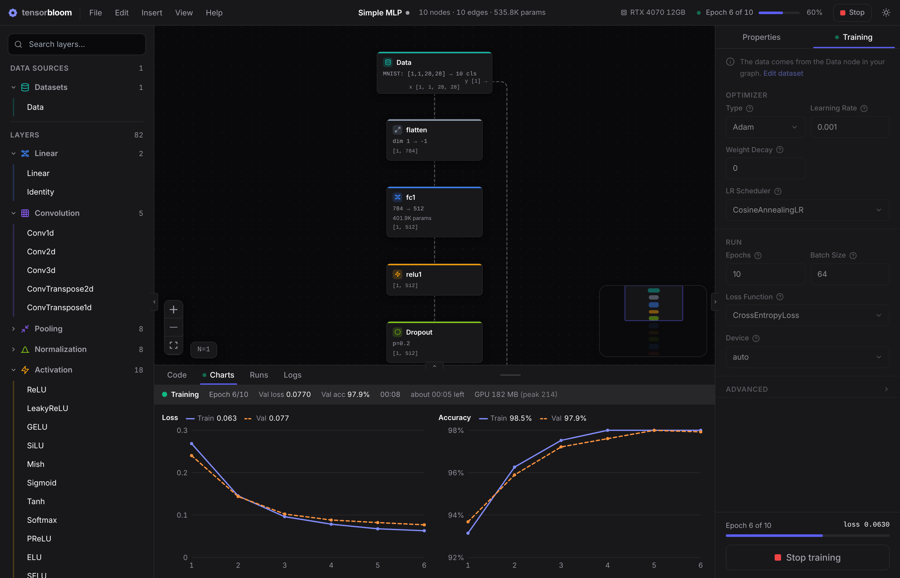
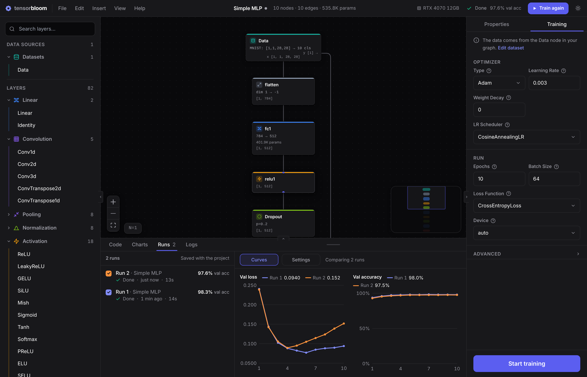
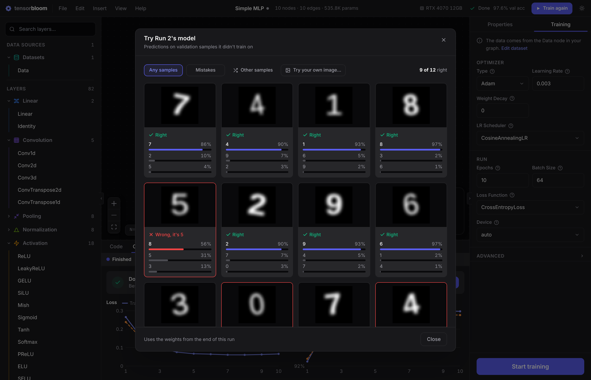

# Training Guide

TensorBloom trains PyTorch models directly from the graph editor. This guide covers all training configuration options.

## Getting Started

1. Build or load a model with a **Data** node and a **Loss** node
2. Open the **Training** tab in the right panel to check the optimizer, learning rate, and epochs
3. Press **Train** in the toolbar, or **Ctrl+Enter**

The training loop runs in the Python sidecar process, so the UI stays fully responsive. Progress is reported in the toolbar and the Charts and Logs tabs.

Every setting in the Training tab has a **?** next to its label that explains what it does.

## Optimizers

Four optimizers are available, each with configurable parameters:

### SGD

Stochastic Gradient Descent with optional momentum and weight decay.

- **Learning rate** — step size (default: 0.01)
- **Momentum** — acceleration factor (default: 0.9)
- **Weight decay** — L2 regularization (default: 0)

Best for: convnets, well-understood architectures where you want fine control.

### Adam

Adaptive learning rates with first and second moment estimates.

- **Learning rate** — (default: 0.001)
- **Betas** — moment decay rates (default: 0.9, 0.999)
- **Weight decay** — L2 regularization (default: 0)

Best for: most tasks, especially when you want fast convergence with minimal tuning.

### AdamW

Adam with decoupled weight decay (Loshchilov & Hutter 2017). Weight decay is applied directly to the parameters rather than through the gradient.

- Same parameters as Adam
- **Weight decay** — (default: 0.01)

Best for: transformers, language models, any architecture where proper regularization matters.

### RMSprop

Adaptive learning rates using running average of squared gradients.

- **Learning rate** — (default: 0.001)
- **Alpha** — smoothing constant (default: 0.99)
- **Momentum** — (default: 0)

Best for: recurrent networks, reinforcement learning.

## Learning Rate Schedulers

Schedulers adjust the learning rate during training. Select one from the Scheduler dropdown.

### StepLR

Multiplies the learning rate by `gamma` every `step_size` epochs.

- **Step size** — epochs between reductions (default: 10)
- **Gamma** — multiplicative factor (default: 0.1)

### CosineAnnealing

Smoothly decreases the learning rate following a cosine curve from the initial value to a minimum.

- **T_max** — total number of epochs for one cosine cycle (default: equals total epochs)
- **Eta min** — minimum learning rate (default: 0)

### OneCycleLR

Ramps up the learning rate, then anneals it down. Often achieves better results in fewer epochs (Smith & Topin 2018).

- **Max LR** — peak learning rate (default: 0.01)
- Automatically configured based on total epochs and steps

### ReduceLROnPlateau

Reduces the learning rate when a metric stops improving. Monitors validation loss.

- **Factor** — multiplicative reduction (default: 0.1)
- **Patience** — epochs to wait before reducing (default: 10)

## Loss Functions

The loss function is determined by the **Loss node** in your graph. Drop a loss node, connect your model's output to it, and connect the Data node's target handle.

Available loss functions:

| Loss | Use Case |
|------|----------|
| **CrossEntropyLoss** | Multi-class classification (expects class indices) |
| **NLLLoss** | Multi-class classification after LogSoftmax |
| **MSELoss** | Regression (continuous targets) |
| **L1Loss** | Regression with outlier robustness |
| **BCELoss** | Binary classification (after Sigmoid) |
| **BCEWithLogitsLoss** | Binary classification (raw logits, more stable) |
| **HuberLoss** | Regression, smooth L1 near zero |
| **SmoothL1Loss** | Regression, similar to Huber |
| **KLDivLoss** | Distribution matching (VAE, knowledge distillation) |
| **CosineEmbeddingLoss** | Similarity learning |
| **TripletMarginLoss** | Metric learning with anchor-positive-negative |
| **HingeEmbeddingLoss** | SVM-style margin loss |
| **CTCLoss** | Sequence-to-sequence without alignment (OCR, ASR) |

## Advanced Settings

Expand the **Advanced** section in the Training panel for additional options.

### Mixed Precision

Enables automatic mixed precision (AMP) training using `torch.cuda.amp`. Operations that benefit from lower precision run in `float16`, while numerically sensitive operations stay in `float32`.

- Reduces GPU memory usage by up to 50%
- Can speed up training on GPUs with Tensor Cores (NVIDIA Volta and later)
- No accuracy loss in most cases

### Gradient Clipping

Clips gradient norms to prevent exploding gradients. Set the **max norm** value (default: 1.0 when enabled).

Recommended for: recurrent networks (LSTM, GRU), transformers, and any model that shows NaN losses during training.

### Early Stopping

Stops training when validation loss stops improving for a specified number of epochs (**patience**). Prevents overfitting and saves time.

- **Patience** — epochs to wait (default: 5)
- Monitors validation loss

### Random Seed

Set a fixed random seed for reproducible training runs. When set, PyTorch, NumPy, and Python random number generators are all seeded.

### Deterministic Mode

Forces PyTorch to use deterministic algorithms. Combined with a fixed seed, this guarantees identical results across runs on the same hardware. May reduce training speed slightly.

## Pre-flight Check

When you start training, a pre-flight check validates your graph before the first epoch. Problems that stop training, such as a missing Loss node, are listed one per line in the Charts tab.

### Suggested Fixes

The check propagates tensor shapes through the entire graph. If it finds a mismatch, for example a Linear layer expecting 256 features but receiving 512, it suggests a fix instead of applying it silently. A dialog lists each change with its reason, such as "fc3 out_features: 12 → 10. Final Linear has out_features=12 but target expects 10", and offers:

- **Fix and train** applies the changes (as one undo step) and starts the run
- **Train without changes** starts the run as the graph is
- **Cancel** leaves everything alone

Fixes cover:
- `in_features` on Linear layers
- `in_channels` on Conv1d, Conv2d, Conv3d layers
- `num_features` on BatchNorm layers
- `input_size`, `embed_dim`, `d_model`, and `num_channels`
- Flatten dimension calculations
- The final layer's output size when it doesn't match the target

The same fixes are offered as you build: the toolbar's problems list and the Properties panel show them as one-click buttons, such as **Set in_features to 512**.

### Target Compatibility

The pre-flight check verifies that the loss function is compatible with the target tensor:
- CrossEntropyLoss expects integer class indices
- MSELoss expects float targets with matching shape
- BCEWithLogitsLoss expects float targets in [0, 1]

## Training Progress

### Toolbar

The **Train** button becomes **Stop** during a run. Next to it, the run's status shows "Checking the model…", "Downloading MNIST…", "Epoch 3 of 10" with a progress bar that counts batches within the epoch, "Stopping…", and finally "Done · 96.0% val acc" or "Run failed". Click the status to open the Charts tab.

### Charts Tab

- Loss and accuracy charts, with train and validation in the same colors in every chart. Validation lines are dashed.
- Hover a chart to read each series' value at that epoch in its header.
- A status strip leads with validation loss and accuracy, the elapsed time, the time left, and GPU memory.
- While the dataset downloads or loads, the tab says so instead of showing empty charts.

When the run ends, a summary card shows how it went, for example "Done in 3m 12s · Best val accuracy 96.1% at epoch 8", with **Try it**, **Export model**, **Train again**, and **Compare with Run N**. A stopped run says where it stopped ("Stopped at epoch 3 of 10").

### When a Run Fails

Errors get a panel with a plain-language hint, the raw message, and **Try again**, **Show logs**, and **Copy error** (the copy includes the traceback). Hints cover shape mismatches, running out of GPU memory, labels out of range, channel mismatches, missing packages, failed downloads, missing files, and a stopped Python process.

### Logs Tab

Detailed per-epoch output including:
- Loss and accuracy values
- Learning rate (when using a scheduler)
- Epoch duration
- GPU memory usage (when training on CUDA)
- CUDA availability warning if no GPU is detected

Lines from stderr have a warning mark in the gutter.

## Comparing Runs

Every run that gets through at least one epoch is kept, and so is a run that fails. Each record holds the run's per-epoch loss and accuracy, its results, its training settings, and the graph it trained. The last 30 runs are saved in the project file and the auto-save.

The **Runs** tab at the bottom lists runs newest first, each with its color, status (Done, Stopped, or Failed), when it ran, how long it took, and its headline number. A failed run shows its error.

- **Curves** draws the checked runs on shared loss and accuracy charts, one color per run. With one run checked, it shows that run's train and validation lines.
- **Settings** puts results, the model, and the training settings side by side. It shows only the rows that differ until you press **Show all settings**. The best values are marked, and each distinct architecture gets a name (Model A, Model B) so a changed model stands out.
- **Restore** brings back a run's graph and training settings. Ctrl+Z brings back the graph you had before.
- **Delete** removes a run.

## Trying a Trained Model

**Try it** in the run summary, or **Try** on a run in the Runs tab, opens a grid of 12 predictions on validation samples the model didn't train on. Each card shows the input, the top three guesses as bars, and "Right" or "Wrong, it's X". The header shows the score, such as "9 of 12 right".

- **Mistakes** looks through up to 5,000 samples for wrong answers
- **Other samples** draws a new set
- **Try your own image** runs the model on an image file, resized to the model's input (offered when the model takes images)

Regression models show predicted values, and autoencoders show the reconstructed image.

The latest run uses the weights still in memory. Older runs use their last checkpoint, and the footer says which is used. It runs the model each run actually trained, so edits to the canvas since then don't get in the way.

